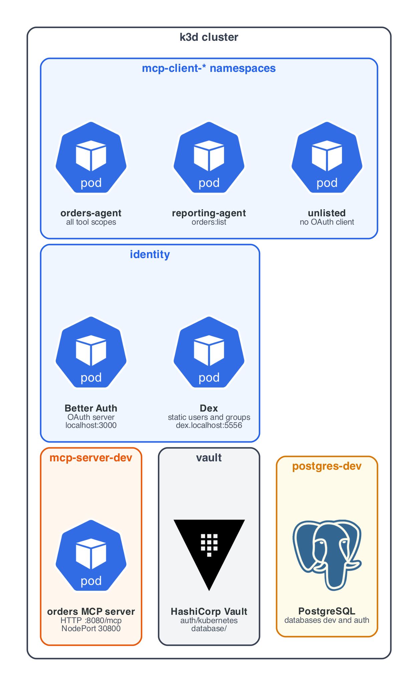

# vault-mcp-identity-lab

Standard OAuth for an MCP server on a local k3d cluster, using Better Auth, Dex and HashiCorp Vault.

- **People** sign in through **Better Auth** and **Dex**, using static lab users such as `testuser`.
- **Client pods** log in to Better Auth with their **Kubernetes ServiceAccount token**. They hold no client secret.
- **Better Auth** decides who gets which OAuth scope and issues **5-minute, audience-bound JWTs**. A person must sign
  in again after 8 hours.
- **The MCP server** on `http://localhost:8000/mcp` verifies those JWTs and allows the tools their scopes map to.
- **HashiCorp Vault** gives the server a **10-minute, `SELECT`-only PostgreSQL user** through a Vault Proxy sidecar,
  and drops it when the pod stops.



> Disclaimer: lab demo only. This repository is for learning and is not a production reference architecture.
> It runs plain HTTP, a single Vault node and static users who all share a public password.

## Quick start

```bash
task init     # pre-commit hooks, Helm repos, .env, Python and Node packages
task all      # k3d, CoreDNS aliases, Vault, PostgreSQL, Dex, Better Auth, MCP server, client pods
task test:all # unit tests + live scenarios M1-M8, A1-A12 and H1-H13
```

Lab users all sign in with the password `password`. Set `DEX_STATIC_PASSWORD` in `.env` before `task all` to change it.

| User | Dex group | Tools |
| --- | --- | --- |
| `testuser@lab.local` | `mcp-orders-reader` | `list_orders`, `get_order`, `whoami` |
| `reportuser@lab.local` | `mcp-orders-reporter` | `list_orders` |
| `nogroupuser@lab.local` | none | none, no token is issued |

### Connect a client

**Claude Code** reads the project's `.mcp.json`. Run `claude`, approve the `orders` server, then use `/mcp` to
authenticate it. Sign in as a lab user and allow access.

**MCP Inspector:** run `task mcp:inspector` and use the OAuth client ID `mcp-inspector`.

To sign in as someone else, open http://localhost:3000/sign-out, then run `claude mcp logout orders` for Claude Code.

### Call the server from a terminal

```bash
TOKEN=$(task mcp:login LAB_USER=testuser)

curl -s -X POST localhost:8000/mcp -H "Authorization: Bearer $TOKEN" \
  -H 'Content-Type: application/json' -H 'Accept: application/json, text/event-stream' \
  -d '{"jsonrpc":"2.0","id":1,"method":"tools/call","params":{"name":"list_orders","arguments":{"status":"pending"}}}'
```

`task mcp:login` performs the real browser flow with `curl`, through Better Auth, Dex and the consent step.

Requirements: Docker or Podman, k3d, kubectl, helm, the vault CLI, jq, uv, Node 22.12 or later, htpasswd and task.
Ports `127.0.0.1:8000`, `3000`, `5556` and `8200` must be free. To change the first three, use `mcp_host_port`,
`auth_host_port` and `dex_host_port`, for example `task all auth_host_port=3100`. Claude Code's sign-in also uses
local port `33418`, and the Inspector uses `6274`. Check tools with `task deps`.

## Docs

- [Solution design](docs/solution-design.md): identities, token flows, authorisation, threat model.
- [Walkthrough](docs/walkthrough.md): every scenario, step by step.
- [Troubleshooting](docs/troubleshooting.md): common failures and fixes.

## Related lab

[`learn-vault-proxy`](https://github.com/nhsy-hcp/learn-vault-proxy) applies the same Vault Proxy socket pattern to plain apps
and covers KV v2 and outage behaviour. This lab's MCP server reuses its credential code.
