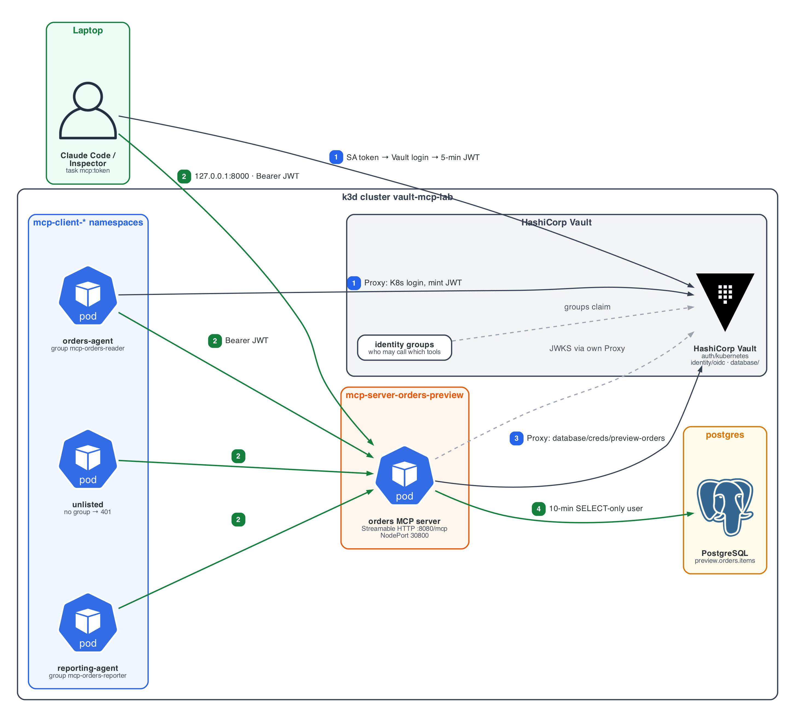
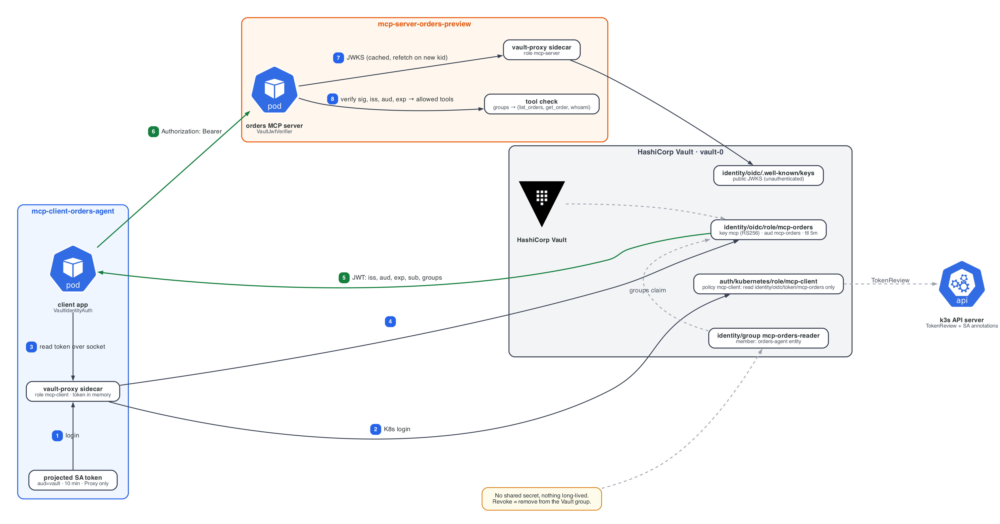
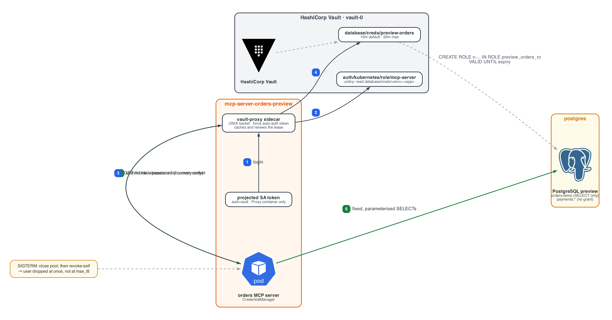
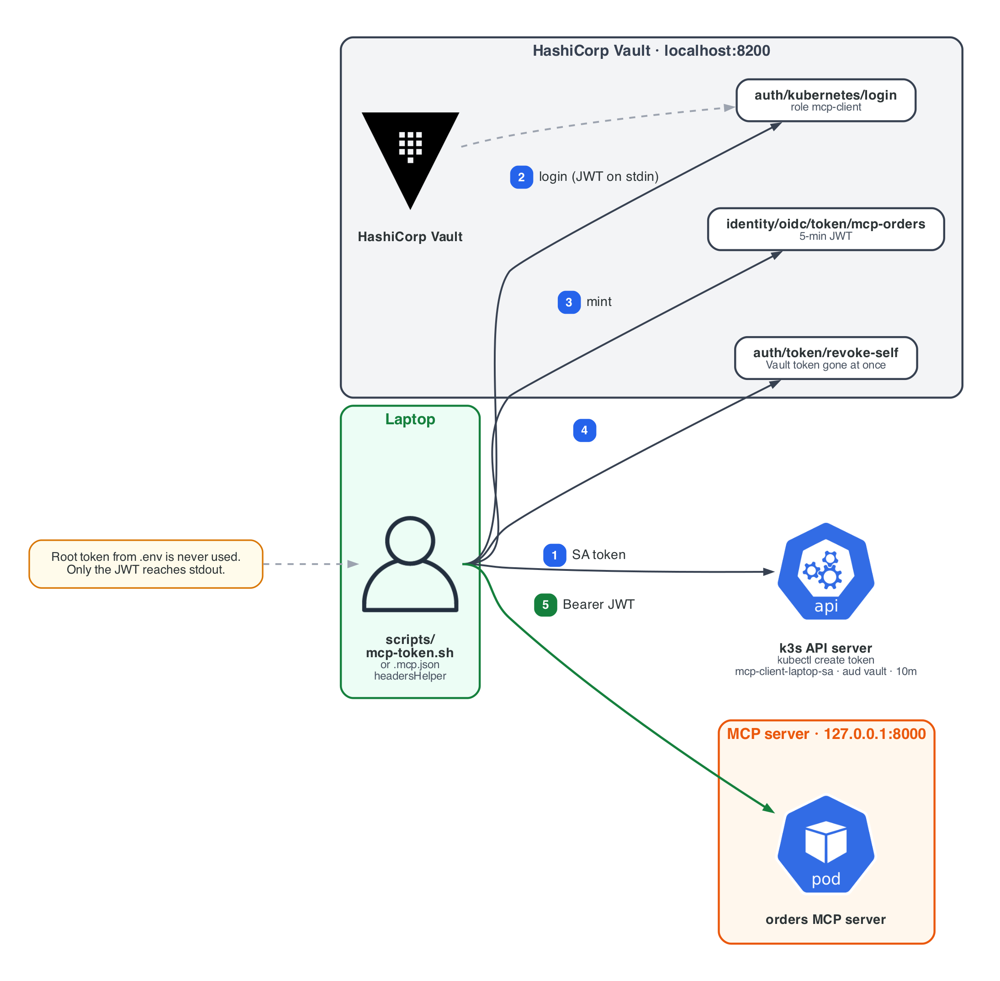

# Solution Design: HashiCorp Vault as an Identity Broker for MCP Auth

## 1. Summary

An MCP server should know who is calling it and give each caller only the tools it needs. It should do this without
anyone handing out API keys or client secrets. In this lab, HashiCorp Vault acts as the identity broker:

1. A client proves who it is with an identity it already has: a pod's Kubernetes ServiceAccount, or the laptop's
   kubeconfig through a dedicated ServiceAccount.
2. Vault swaps that for a **5-minute JWT**, scoped to one audience (`aud=mcp-orders`) and signed with Vault's own
   key. The JWT's `groups` claim lists the caller's **Vault identity groups**.
3. The MCP server checks the JWT against Vault's public keys (JWKS), then allows the tools those groups map to.
4. The server reaches its own data with a **10-minute PostgreSQL user** that Vault creates for it. That user has
   `SELECT` on one table and is dropped when the pod stops.

No pod, script or config file holds a long-lived secret. To revoke a client, remove it from a Vault group; its next
token has no access, and any token it already holds expires within 5 minutes.



**Platform:** k3d (`vault-mcp-lab`), HashiCorp Vault 2.2.2 (single-node Raft), PostgreSQL 16 and MCP Python SDK 2.3. MCP
is on `http://127.0.0.1:8000/mcp` (NodePort 30800) and Vault on `http://127.0.0.1:8200` (NodePort 30820), both
bound to loopback only. Vault uses its default mount paths: `auth/kubernetes`, `database/` and the built-in
`identity/oidc`.

## 2. Goals and non-goals

**Goals**

- No long-lived credential anywhere. Client JWTs last 5 minutes, Vault tokens 15/30 minutes, database users
  10/30 minutes, and ServiceAccount tokens 10 minutes.
- Least privilege on both sides:
  - A client may only mint one token type. It cannot read secrets or database credentials.
  - The server may only read its own `database/creds` path. It cannot mint client tokens.
- Vault decides who may call which tools: identity group membership, held centrally and auditable.
- The laptop (Claude Code, MCP Inspector, `curl`) uses the same broker, with no static token.
- No Vault client library (`hvac`): the apps talk to Vault Proxy over a UNIX socket with the standard library.

**Non-goals**

- OAuth 2.1 authorization-code flow for humans (see section 9).
- TLS and HA.
- Free-form SQL tools.

## 3. Identities

| Identity | Namespace / ServiceAccount | Vault auth role | Vault policy | Vault group |
| --- | --- | --- | --- | --- |
| MCP server | `mcp-server-orders-preview` / `…-sa` | `mcp-server` | `mcp-server` (templated) | none |
| Orders agent | `mcp-client-orders-agent` / `…-sa` | `mcp-client` | `mcp-client` | `mcp-orders-reader` |
| Reporting agent | `mcp-client-reporting-agent` / `…-sa` | `mcp-client` | `mcp-client` | `mcp-orders-reporter` |
| Laptop (no pod) | `mcp-client-laptop` / `…-sa` | `mcp-client` | `mcp-client` | `mcp-orders-reader` |
| Unlisted agent | `mcp-client-unlisted` / `…-sa` | `mcp-client` | `mcp-client` | none (fails closed) |

- **Role bindings:** each auth role is bound by glob. `mcp-server` accepts only `mcp-server-*-sa` in
  `mcp-server-*` namespaces; `mcp-client` accepts only `mcp-client-*-sa` in `mcp-client-*`. Both require token
  audience `vault`.
- **Aliases:** `alias_name_source` is the default, `serviceaccount_uid`. A deleted and recreated ServiceAccount is a
  new alias and does not inherit the old one's group membership until `config:mcp-auth` runs again.
- **Entities ahead of first login:** `scripts/config-mcp-auth.sh` creates each client's Vault entity and alias
  (alias name = SA UID) so the client can join a group before it ever logs in.

## 4. Vault configuration

**Policies:**

```hcl
# mcp-server (accessor substituted at config time)
path "database/creds/{{identity.entity.aliases.<accessor>.metadata.environment}}-{{identity.entity.aliases.<accessor>.metadata.application_name}}" {
  capabilities = ["read"]
}

# mcp-client
path "identity/oidc/token/mcp-orders" {
  capabilities = ["read"]
}
```

The server reads JWKS from `identity/oidc/.well-known/keys`. That endpoint needs no authentication, so no grant is
required. `deny_slash_in_templated_paths = true` is set in the server config, so a `/` in an annotation value
cannot widen the templated path (CVE-2026-5006).

**Identity tokens** (`scripts/config-mcp-auth.sh`):

| Setting | Value | Why |
| --- | --- | --- |
| `identity/oidc/config issuer` | `http://vault.vault.svc.cluster.local:8200` | A fixed `iss` (`…/v1/identity/oidc`), whichever address minted the token |
| `identity/oidc/key/mcp` | RS256, `rotation_period=24h`, `verification_ttl=24h`, `allowed_client_ids=mcp-orders` | Asymmetric key; old public keys stay published until tokens signed with them expire |
| `identity/oidc/role/mcp-orders` | `key=mcp`, `client_id=mcp-orders`, `ttl=5m` | `aud` = `mcp-orders`; short lifetime |
| Claims template | `groups` ← `{{identity.entity.groups.names}}`; `environment`, `application_name`, `team` ← SA annotations | Groups authorise; annotations are informational only |

A token looks like this:

```json
{"iss": "http://vault.vault.svc.cluster.local:8200/v1/identity/oidc", "aud": "mcp-orders", "sub": "<entity id>",
 "exp": 1794924600, "iat": 1794924300, "groups": ["mcp-orders-reader"], "environment": "preview",
 "application_name": "orders-agent", "team": "ai-platform", "namespace": "root"}
```

## 5. Token flow



1. The client's Vault Proxy sidecar logs in to `auth/kubernetes` with the pod's projected ServiceAccount token
   (`aud=vault`, 10 minutes, mounted only in the Proxy container). The resulting Vault token never leaves Proxy's
   memory.
2. The client app reads `identity/oidc/token/mcp-orders` over the UNIX socket. Proxy adds its own token
   (`use_auto_auth_token = "force"`). Identity tokens have no lease, so Proxy doesn't cache them; each read mints a
   new one.
3. `VaultIdentityAuth` (`app/src/mcp_lab/client.py`) caches the JWT until 60 seconds before expiry and sends it as
   `Authorization: Bearer`.
4. `VaultJwtVerifier` (`app/src/mcp_lab/auth.py`) checks the token:
   - Allows `RS256` only.
   - Looks up the `kid` in the JWKS, read through the server's own Proxy and cached. An unknown `kid` triggers at
     most one refetch every 10 seconds, so forged kids can't flood Vault.
   - Requires `iss`, `aud`, `exp`, `iat` and `sub`.
   - Maps `groups` through a fixed table in code, `GROUP_TOOLS`. No known group gives `401`.
5. Every tool calls `require(<tool>)` first. A tool outside the caller's groups returns an MCP tool error. The
   client's token is never forwarded anywhere.

| Group | Tools |
| --- | --- |
| `mcp-orders-reader` | `list_orders`, `get_order`, `whoami` |
| `mcp-orders-reporter` | `list_orders` |

The control is split on purpose. Who is in a group is runtime state in Vault, changed by platform admins and
audited. What a group may call is code, changed by pull request and tested.

## 6. Server-side credentials



The server keeps the pattern from `learn-vault-proxy`. A Vault Proxy native sidecar runs with `role mcp-server`.
`CredentialManager` reads `database/creds/preview-orders` over the socket, opens a small connection pool, and
refreshes at two thirds of the lease (capped at 60 seconds). It swaps the pool when the username changes, recovers
from revocation with `cache-clear`, and on SIGTERM closes the pool and calls `revoke-self`.

The database user inherits `preview_orders_ro`: `USAGE` on schema `orders` and `SELECT` on `orders.items`. Nothing
else is granted. Schema `payments` in the same database holds a canary that no MCP identity can read.

## 7. Laptop access



`task mcp:token` (`scripts/mcp-token.sh`) works like this:

1. `kubectl create token mcp-client-laptop-sa --audience vault --duration 10m`.
2. Log in to `auth/kubernetes` on `localhost:8200`, with the JWT on stdin.
3. Read `identity/oidc/token/mcp-orders`.
4. `vault token revoke -self`, then print only the JWT.

The root token in `.env` is explicitly unset, and nothing is written to disk. `.mcp.json` sets
`scripts/mcp-headers.sh` as Claude Code's `headersHelper`, so Claude Code fetches fresh headers instead of storing
one.

The trust anchor for the laptop is the operator's kubeconfig: whoever can create tokens for `mcp-client-laptop-sa`
can act as the laptop client.

## 8. Threat model

| Threat | Control | Residual risk |
| --- | --- | --- |
| Stolen client JWT | 5-minute TTL; `aud=mcp-orders`, so no other server accepts it | Replayable until `exp`; there is no TLS in the lab |
| Forged or altered JWT | RS256 signature against Vault's JWKS; `alg` pinned; `iss`, `aud`, `exp` and `iat` required | None known |
| Client widens its own access by editing SA annotations | Tools come from Vault groups, not annotations; app teams have read-only RBAC on ServiceAccounts | Annotations still drive the server's DB path template; protected by RBAC and `deny_slash_in_templated_paths` |
| Compromised client pod reads data directly | `mcp-client` policy allows one `identity/oidc/token` path; `database/creds` gives `403` (A4) | It can call the tools its group allows until removed |
| Compromised server mints client tokens | `mcp-server` policy has no `identity/oidc/token` grant (A3) | It has its own data access: `SELECT` on one table |
| Prompt injection or SQL injection through tool arguments | Fixed, parameterised SQL; `limit` clamped to 50; DB grant is `SELECT` on one table | Data in `orders.items` is readable by allowed callers |
| Vault token theft | No sink: Vault tokens exist only in Proxy memory; laptop tokens are revoked straight after use | Memory dump of a Proxy process |
| DNS rebinding against `localhost:8000` | MCP SDK `TransportSecuritySettings.allowed_hosts`; NodePort bound to `127.0.0.1` | None for the demo |
| Signing key rotation breaks clients | JWKS refetched on unknown `kid`; `verification_ttl=24h` keeps old keys published | None |

**Demo-only shortcuts:**

- Plain HTTP everywhere.
- Root token used for configuration.
- Unseal keys in `vault-init.json`.
- Single Vault node.
- `sslmode=disable`.

## 9. Limits and next steps

- **Standard MCP OAuth for humans.** Claude Code and the Inspector speak OAuth 2.1 with discovery. Here they use a
  pre-minted bearer token instead. The SDK already serves protected resource metadata that names Vault as the
  issuer. A full flow needs an authorization server: Vault's OIDC provider, Keycloak or another IdP. In that flow
  the MCP server would still verify tokens and never forward them to Vault.
- **Per-user identity.** The Vault entity in the audit log is the workload, not the human behind it.
- **Vault Enterprise features** such as:
  - namespaces per team;
  - Sentinel (for example, no production tokens out of hours);
  - control groups (a human approves a sensitive tool);
  - agent identity with on-behalf-of tokens, so the user and the agent both appear in the audit log.

## 10. Acceptance tests

`task test:all` runs the unit tests, then `demo:mcp` (M1–M8) and `demo:mcp-auth` (A1–A12) against the live lab.
See `docs/walkthrough.md` for what each scenario shows.
