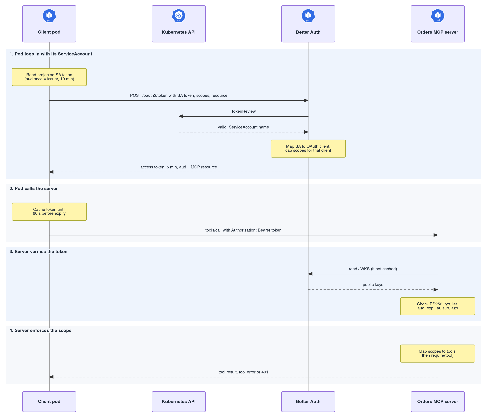
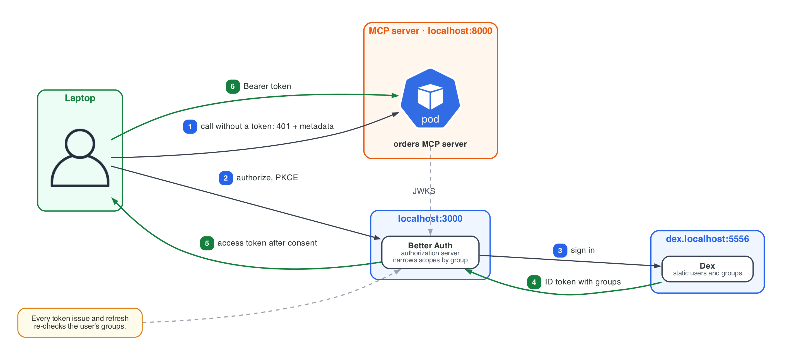

# Solution Design: OAuth for MCP with Better Auth, Dex and HashiCorp Vault

## 1. Summary

An MCP server should know who is calling it and give each caller only the tools it needs. This lab uses standard
OAuth 2.1 to do that, with each component doing one job:

| Component | Job |
| --- | --- |
| **Better Auth** | OAuth authorization server. Decides who gets which scope and issues every access token |
| **Dex** | Human identity and groups, from static lab users |
| **Kubernetes** | Workload identity. Pods prove who they are with a projected ServiceAccount token |
| **Orders MCP server** | Resource server. Verifies access tokens and enforces the scope each tool needs |
| **HashiCorp Vault** | Gives the MCP server dynamic PostgreSQL credentials through Vault Proxy |

Access tokens last 5 minutes and are bound to the MCP resource. A person's sign-in lasts at most 8 hours, however often
their client refreshes. Client pods hold no client secret, and the server's
app container holds no Vault token.


**Platform:** k3d (`mcp-oauth-lab`), Better Auth 1.7.25, Dex 2.46.1, HashiCorp Vault 2.2.2 (single-node Raft),
PostgreSQL 16 and MCP Python SDK 2.3. All laptop ports are bound to `127.0.0.1`.

| Service | Laptop and pod URL |
| --- | --- |
| MCP server | `http://localhost:8000/mcp` on the laptop, `http://mcp-orders.mcp-server-dev.svc/mcp` in the cluster |
| Better Auth | `http://localhost:3000` on the laptop, `http://auth.localhost:3000` in the cluster |
| Dex | `http://dex.localhost:5556/dex` |
| Vault | `http://127.0.0.1:8200` on the laptop |

## 2. Goals and non-goals

**Goals**

- Standard MCP OAuth for people, with per-user identity in tokens and logs.
- No long-lived credential in client pods or the server's app container.
- One place decides access: Better Auth. The MCP server only enforces what the token says.
- Least privilege for clients through per-tool scopes, and for the server through one Vault database path.
- No Vault client library (`hvac`): the server talks to Vault Proxy over a UNIX socket with the standard library.

**Non-goals**

- TLS and high availability.
- A real identity provider behind Dex.
- Free-form SQL tools.

## 3. One issuer, two routes

Every token names one issuer: `http://localhost:3000/api/auth`. MCP clients accept plain HTTP for an OAuth server only
on an exact loopback host, so the public URL must be `localhost`.

- On the laptop, `localhost:3000` reaches Better Auth through a k3d port mapping, and `dex.localhost:5556` reaches Dex.
- In the cluster, `localhost` would mean the pod itself, so `auth/coredns-custom.yaml` rewrites `auth.localhost` and
  `dex.localhost` to their Services. Pods use `auth.localhost` for the token endpoint and JWKS.
- Each Service port equals its laptop port. Better Auth runs with a fixed base URL, so the issuer does not depend on
  which route a request used.

## 4. Identities

| Identity | Authenticates with | OAuth client | Scopes |
| --- | --- | --- | --- |
| `testuser` | Dex password, group `mcp-orders-reader` | `claude-code`, `mcp-inspector` or `lab-cli` | `orders:list`, `orders:get`, `whoami` |
| `reportuser` | Dex password, group `mcp-orders-reporter` | as above | `orders:list` |
| `nogroupuser` | Dex password, no group | as above | none, so no token |
| Orders agent pod | ServiceAccount `mcp-client-orders-agent-sa` | `orders-agent` | `orders:list`, `orders:get`, `whoami` |
| Reporting agent pod | ServiceAccount `mcp-client-reporting-agent-sa` | `reporting-agent` | `orders:list` |
| Unlisted pod | ServiceAccount `mcp-client-unlisted-sa` | none | none, so no token |
| MCP server | ServiceAccount `mcp-server-dev-sa`, to Vault only | none | not applicable |

OAuth clients are pre-registered by a seed Job from `auth/public-clients.json` and `auth/mcp-clients.json`. The Job
corrects changed clients and removes clients no longer listed. Dynamic client registration is off, and only the seed
identity can manage clients.

## 5. Authorisation

Better Auth makes the decision, using `auth/group_scopes.json`:

| Dex group | Scopes it may hold |
| --- | --- |
| `mcp-orders-reader` | `orders:list`, `orders:get`, `whoami` |
| `mcp-orders-reporter` | `orders:list` |

1. **At consent**, a server-side hook narrows the requested scopes to those the user's groups allow. A client can
   request every scope, and the user still receives only their own.
2. **At every user token issue and refresh**, Better Auth targets the MCP resource and refuses scopes beyond that set.
   This also covers a tampered consent record.
3. **At each Dex sign-in**, the user's stored consents are cleared, so the next authorization is narrowed again.
   Token issue and refresh stop 8 hours after that sign-in (`sign_in_ttl_seconds`), so new groups always take effect.
4. **At the MCP server**, `app/src/mcp_lab/scope_tools.toml` maps scopes to tools, and each tool calls `require()`.

| Scope | Tool |
| --- | --- |
| `orders:list` | `list_orders` |
| `orders:get` | `get_order` |
| `whoami` | `whoami` |
| none | `delete_order`: listed, but no scope grants it, so every caller gets "permission denied" |

Groups and `preferred_username` come from the Dex ID token verified and stored at the last sign-in. Users cannot edit
them because Better Auth's profile and account-linking endpoints are disabled. A tool outside the token's scopes
returns an MCP tool error.

## 6. Token flows

### Client pods



1. The pod reads its projected ServiceAccount token, with the Better Auth issuer as audience and a 10-minute lifetime.
2. `ClientCredentialsAuth` sends it to `/oauth2/token` using `client_credentials`, a custom client assertion type, the
   pod's scopes and the MCP resource.
3. The `kubernetes_service_account` method in `auth/src/serviceAccount.ts` calls Kubernetes TokenReview. It refuses the
   request unless the token is valid, has this audience, and its exact ServiceAccount maps to a seeded client.
4. Better Auth caps the scopes at that client's `client_credentials_scopes` and issues the token.

### People



1. The client calls the MCP server, gets `401`, and reads the protected resource metadata that names Better Auth.
2. It runs the authorization code flow with PKCE using its pre-registered client ID.
3. Better Auth sends the browser to Dex. Dex checks the password and returns an ID token with the user's groups.
4. The user approves consent, the scopes are narrowed, and the client receives its tokens.

### Token verification

`OAuthJwtVerifier` (`app/src/mcp_lab/auth.py`) requires ES256, `typ=at+jwt`, the Better Auth issuer, the MCP resource in
`aud`, and `exp`, `iat`, `sub`, `azp` and `scope`. JWKS is cached, and an unknown `kid` triggers at most one refetch
every 10 seconds. A token with no known scope gets `401`.

## 7. Server-side credentials


A Vault Proxy native sidecar runs with role `mcp-server`. `CredentialManager` reads `database/creds/dev-orders` over the
socket, opens a small connection pool, and refreshes at two thirds of the lease (capped at 60 seconds). It swaps the
pool when the username changes, recovers from revocation with `cache-clear`, and on SIGTERM closes the pool and calls
`revoke-self`.

The database user inherits `dev_orders_ro`: `USAGE` on schema `orders` and `SELECT` on `orders.items`. Schema `payments`
in the same database holds a canary that no MCP identity can read. Better Auth has its own `auth` database and owner.

```hcl
# mcp-server (accessor substituted at config time)
path "database/creds/{{identity.entity.aliases.<accessor>.metadata.environment}}-{{identity.entity.aliases.<accessor>.metadata.application_name}}" {
  capabilities = ["read"]
}
```

## 8. Threat model

| Threat | Control | Residual risk |
| --- | --- | --- |
| Stolen access token | 5-minute TTL; bound to the MCP resource | Replayable until `exp`; no TLS in the lab |
| Forged or altered token | ES256 signature against Better Auth's JWKS; `alg` and `typ` pinned; claims required | None known |
| User obtains extra scopes | Narrowed at consent and refused at every user token issue and refresh | Group changes apply at the next sign-in, within 8 hours; existing access tokens last until they expire |
| User edits identity or groups | Taken from the Dex ID token; profile and account-linking endpoints disabled | None known |
| Session or ID token used as an access token | Session JWT endpoint disabled; server requires `typ=at+jwt` and the MCP audience | None known |
| Stolen pod ServiceAccount token | Audience-bound, expires within 10 minutes, checked by TokenReview | Replayable until it expires, because a projected token is reused and has no single-use check |
| Wrong pod claims a client | Exact ServiceAccount to client mapping | Anyone who can run a pod as that ServiceAccount acts as that client |
| Compromised client pod reads data directly | The pod has no Vault Proxy and no Vault role | It can call the tools its scopes allow until disabled |
| Rogue OAuth client registers itself | Dynamic registration off; client management limited to the seeder | None known |
| Compromised server | One Vault path; `SELECT` on one table; it cannot authenticate as an OAuth client | It has its own data access |
| Prompt or SQL injection through tool arguments | Fixed, parameterised SQL; `limit` clamped to 50 | Data in `orders.items` is readable by allowed callers |
| DNS rebinding against `localhost:8000` | `allowed_hosts`; NodePorts bound to `127.0.0.1` | None for the demo |

**Demo-only shortcuts:**

- Every static user shares a public password, `password` by default.
- Better Auth's browser cookies are on `localhost`, which is shared by every local port.
- Plain HTTP everywhere.
- Root token used for Vault configuration, and unseal keys in `vault-init.json`.
- Single Vault node and `sslmode=disable`.
- Generated secrets are stored in plain Kubernetes Secrets.
- Non-expiring token-reviewer ServiceAccount token stored in Vault.

## 9. Limits and next steps

- **Real identity provider.** Replace Dex's static users with a connector. Better Auth does not change.
- **Sender-constrained tokens.** DPoP would stop a stolen access token being replayed.
- **`insufficient_scope` responses.** Scope is checked inside each tool, so a missing scope is an MCP tool error
  rather than an HTTP `403` that triggers step-up consent.
- **High availability and TLS** for Better Auth, Dex, Vault and PostgreSQL.

## 10. Acceptance tests

`task test:all` runs the unit tests, then `demo:mcp` (M1-M8), `demo:mcp-auth` (A1-A12) and `demo:human-auth` (H1-H13)
against the live lab. See `docs/walkthrough.md` for what each scenario shows.
